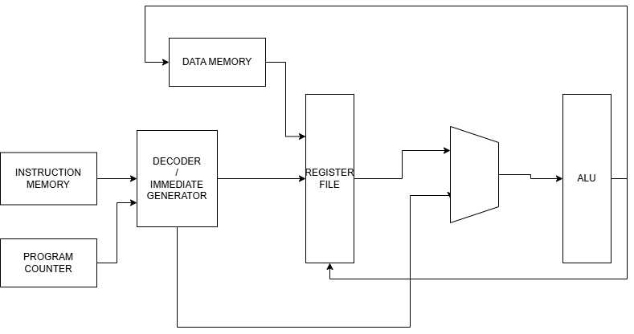

# Single-Cycle RISC-V (RV32I) CPU Design

This repository contains an experimental structural Verilog implementation of a **Single-Cycle RISC-V Processor** based on the **RV32I Instruction Set Architecture (ISA)**. This project was developed as a core part of my engineering portfolio to demonstrate expertise in digital logic design and computer architecture.

---

**Technical Specifications**
* **Architecture:** RISC-V (RV32I)
* **Design Type:** Single-Cycle Datapath
* **Hardware Description Language:** Verilog HDL
* **Key Modules:** ALU, Register File, Control Unit, Instruction Decoder, Data Memory.

---

## Processor Architecture

### 1. Functional Block Diagram
The following diagram illustrates the high-level logic flow and data movement between the main components of the CPU.

### 2. RTL Schematic
Generated via synthesis tools, this schematic shows the gate-level implementation and hardware interconnections of the design.

---

**Hüsnü Onur**
* Electrical & Electronics Engineering Student
* Focus: Computer Architecture, RTL Design, and Digital Systems.Experimental structural Verilog implementation of a Single-Cycle RISC-V (RV32I) Processor
